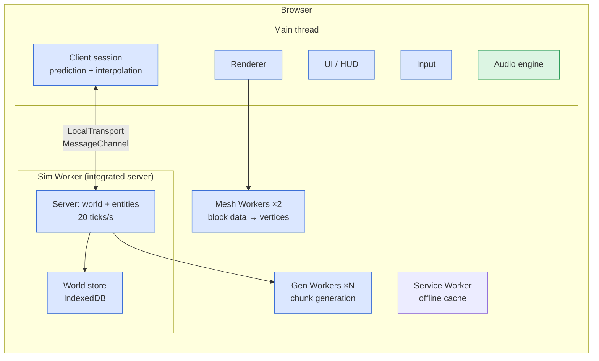

# VibeCraft Architecture

VibeCraft is a browser-native, offline-first voxel sandbox in the spirit of Minecraft. Open a URL, pick a world,
play. No download, no account, no server. Works offline after the first visit. All art and sound are original.

Reference point: [vel.gg/bo1z](https://vel.gg/bo1z) runs Black Ops 1 Zombies in a browser tab with the same promise
(free, no download, solo). VibeCraft applies that promise to a Minecraft-style game.

Related notes: [[decisions]] · [[todo]] · [[agent-protocol]] · [[art-direction]] · [[sound-design]]

## 0. Reading guide

- §1 defines the product. §2 is the hierarchy (L0 → L3) and the dependency rules. §3 is the repo tree.
- §4–§13 go deep on each subsystem: runtime, world, simulation, networking, rendering, UI/shell, audio,
  persistence, content/assets/legal, tooling.
- §14 maps every subsystem to one of the four agents. §15 is the roadmap. §16 lists the choices you should
  confirm or overrule.
- **MUST** = hard constraint. **SHOULD** = default; change it with an ADR in [[decisions]], not silently.

## 1. Product definition

### 1.1 What "offline Minecraft" means here

Three requirements, all in v1:

1. **No account.** Nothing to sign in to. Player identity is a local profile (name + skin) in the browser.
2. **No download, no install.** Playable at a URL. Installable as a PWA for a desktop icon, never required.
3. **Works offline.** After the first visit the service worker holds everything. Airplane mode still plays.
   Worlds live in IndexedDB in the browser and can be exported to a file.

### 1.2 Player promise (success criteria)

- Landing page → standing in a world in under 10 s on a mid-range laptop over broadband.
- 60 FPS at render distance 8 on an integrated GPU (Intel Iris Xe class). 30 FPS floor at distance 12.
- Feels like Minecraft: blocky terrain, caves, day/night, mine, craft, build, a handful of mobs, survival loop.
- Looks and sounds like itself: original textures, UI, music and SFX with a consistent style.
- Never loses a world: autosave, export to a file, import from a file.

### 1.3 Reference pattern from vel.gg/bo1z (what we copy)

Studied on 2026-10-09 (`landing.js`, `kino.html`):

- The landing is the game's own select screen rebuilt from art panels. It fetches **nothing** of the game until a
  pick: no manifest, pack or engine file.
- A pick loads the game page **into the same document** so the click's user activation carries over and the
  audio context can start without a second click.
- Only the picked map's manifest and pack are requested. Engine code is split and lazy loaded.
- Options are minimal: mouse sensitivity, master volume, fullscreen. Pointer lock with a "Click to resume" veil.
- A `?perf=1` query enables a performance overlay that is otherwise never fetched.
- Link cards (`og:*`) are composed from the site's own art so shared links preview well.

VibeCraft keeps all six behaviours (§9.1, §9.5, §13.3).

### 1.4 Non-goals (v1)

- **Not a Minecraft client.** It does not speak the Minecraft protocol and cannot join Minecraft servers or
  load Minecraft worlds. (Anvil `.mca` import is a candidate v2 spike, see §16.)
- **No Mojang/Microsoft assets or code, ever.** See §12.4.
- **No mod loader.** Content is data-driven packs (§12.1). Scripting/mods are v2.
- **No accounts, payments, ads, telemetry.**
- **No mobile-first UI** in v1. It must not break on touch, but controls are keyboard + mouse.

## 2. System hierarchy

Four levels: **L0** product → **L1** subsystems → **L2** modules (one npm package or app each) → **L3**
components (one or a few files each). Owners in brackets; the full ownership map is §14.

```
VibeCraft (L0)
│
├── 1  Shell & Platform ............ apps/web                       [Code Master; art: Visual Arts]
│     ├── Landing / World Select       art-driven select screen, loads no engine until a pick
│     ├── Game Shell                   canvas host, pointer lock, resize, lifecycle, error veil
│     ├── Options & Profiles           settings store, local player profile, keybinds
│     ├── PWA                          service worker, manifest, install prompt, update flow
│     └── Diagnostics                  ?perf=1 overlay, crash screen, log export
│
├── 2  Engine Core ................. packages/core · world · sim    [Code Master]
│     ├── core                         math, RNG, noise, event bus, scheduler, object pools, logging
│     ├── world                        block registry, chunk store, palettes, lighting, worldgen
│     └── sim                          entities (ECS-lite), physics, inventory, crafting, rules, tick loop
│
├── 3  Rendering ................... packages/renderer              [Code Master; look: Visual Arts]
│     ├── GL layer                     context, resources, texture arrays, shader programs, state cache
│     ├── Chunk mesher                 worker pool, culled+AO meshing, mesh cache, dirty tracking
│     ├── Passes                       sky · opaque · cutout · translucent · entities · particles · overlay
│     └── Camera & view                FOV, bobbing, frustum culling, selection box, first-person item
│
├── 4  Simulation Server ........... packages/sim (headless) · apps/server   [Code Master]
│     ├── Integrated server            sim in a Worker for singleplayer, same code as dedicated
│     ├── Dedicated server             Node process, WebSocket, multiple players
│     └── Authority                    validation, anti-cheat basics, interest management
│
├── 5  Networking .................. packages/net · contracts/protocol   [Code Master; protocol: Chief]
│     ├── Transport                    LocalTransport (MessageChannel) · WebSocketTransport
│     ├── Codec                        versioned binary packets, zero-copy buffers
│     └── Replication                  chunk streaming, entity sync, client prediction + reconciliation
│
├── 6  Persistence ................. packages/storage               [Code Master]
│     ├── World store                  IndexedDB per world, chunk codec, deflate, versions + migrations
│     ├── Export / Import              .vcw zip, drag-drop import, quota + persist() handling
│     └── Autosave                     interval, on pause, on visibilitychange
│
├── 7  Audio ....................... packages/audio · assets/sound  [Sound Master]
│     ├── Audio engine                 Web Audio graph, buses, spatializer, effects, ducking
│     ├── Sound events                 registry (content/sound-events.json) + router from game events
│     ├── Music & ambience             music director state machine, biome/time/depth ambience layers
│     └── Sound pipeline               normalize, encode, loop points, manifest
│
├── 8  Content & Art ............... content/ · assets/art · tools/   [Visual Arts; data: Code Master; schemas: Chief]
│     ├── Definitions                  blocks, items, recipes, entities, biomes, loot (JSON, schema-validated)
│     ├── Art                          block textures, item icons, entity models+skins, UI, fonts, landing art
│     └── Art pipeline                 texture array packer, sprite sheets, model compiler, manifest
│
├── 9  UI .......................... packages/ui                    [Code Master; design: Visual Arts]
│     ├── HUD                          hotbar, health/hunger/air/xp, crosshair, chat, debug (F3)
│     ├── Screens                      pause, options, inventory/crafting, death, world create/edit
│     └── Input                        action map, rebinding, mouse/keyboard (gamepad v2), a11y
│
└── 10 Tooling & DevX .............. packages/mcp-server · tools/ · scripts/   [Code Master; process: Chief]
      ├── MCP server                   dev-only bridge: inspect/drive the running game from Claude
      ├── Test harness                 Vitest, Playwright, golden seeds, perf budgets
      └── Build & gates                Vite, tsc, ESLint, npm run check, agent scripts
```

### 2.1 Dependency rules (enforced by ESLint `no-restricted-imports` + `tsconfig` references)

```
contracts ← core ← world ← sim ← net
                                  ↑
            renderer · ui · audio · storage  (browser-only leaves; depend on contracts/core, read sim state via net)
                                  ↑
                               apps/web            apps/server → contracts · core · world · sim · net · storage
```

- `contracts` has **zero** dependencies. Everything may import it. It holds types, IDs, JSON schemas and the
  protocol definition. Chief owns it; changes go through an ADR.
- `core`, `world`, `sim`, `net`, `storage` **MUST** be DOM-free. They run in Workers and in Node.
- `renderer`, `ui`, `audio` are browser-only and **MUST NOT** be imported by `sim` or `apps/server`.
- `audio` never reads world state directly. It receives **sound events** (§10.3) and a listener pose.
- A package's public API is its `index.ts`. No deep imports across packages.
- `apps/*` compose packages; they contain no engine logic.

## 3. Monorepo layout

npm workspaces, TypeScript strict, Vite. One `node_modules` at root.

```
vibecraft/
├── apps/
│   ├── web/                      playable site: landing + game shell, Vite, PWA
│   │   ├── index.html            landing (world select) — tiny, art only
│   │   ├── play.html             game page loaded into the landing document on pick
│   │   ├── src/
│   │   │   ├── landing/          select screen logic (entries, hotspots, art preload)
│   │   │   ├── shell/            GameShell: canvas, pointer lock, resize, lifecycle, veils
│   │   │   ├── boot/             startup sequence (§4.4), lazy imports of engine chunks
│   │   │   ├── settings/         settings store (localStorage), profile
│   │   │   ├── pwa/              service worker registration, update prompt
│   │   │   └── diagnostics/      perf overlay (?perf=1), crash screen, log export
│   │   └── public/
│   │       ├── art/              exported landing/UI art (webp) — from assets/art via tools
│   │       └── generated/        gitignored build outputs of the asset pipelines
│   └── server/                   dedicated multiplayer server (Node 24, ws)
│       └── src/                  main.ts, config, world dir, admin console
│
├── packages/
│   ├── contracts/                [Chief] shared types, IDs, schemas, protocol — zero deps
│   │   └── src/
│   │       ├── ids.ts            BlockId, ItemId, EntityId, SoundEventId, namespaced string ids
│   │       ├── protocol/         packet enum, payload types, version
│   │       ├── schemas/          JSON schemas for content/*.json (blocks, items, recipes, sound-events, models)
│   │       ├── events.ts         GameEvent union (what the sim emits; audio/ui/renderer consume)
│   │       └── save.ts           save format version + chunk record shape
│   ├── core/                     math (vec3, aabb, ray), RNG (xoshiro), noise (simplex/perlin), EventBus,
│   │                             Scheduler, Pool, Logger, TypedArray helpers
│   ├── world/                    BlockRegistry, Chunk/Section storage, Palette codec, Light engine,
│   │                             WorldGen pipeline + biome/cave/ore stages, structure hooks
│   ├── sim/                      ECS-lite (components, systems), Physics, Player, Inventory, Crafting,
│   │                             Mobs+AI, GameRules, TickLoop, headless Server class
│   ├── net/                      Transport interface, LocalTransport, WebSocketTransport, Codec,
│   │                             ClientSession, ServerSession, Replication (chunks, entities), Prediction
│   ├── renderer/                 GL context, TextureArray, Shaders (GLSL), ChunkMesher (worker),
│   │                             MeshCache, Passes, Camera, Particles, EntityRenderer, Debug lines
│   ├── ui/                       HUD, screens, Preact components, InputMap, a11y utilities
│   ├── audio/                    [Sound Master] AudioEngine, Buses, Spatializer, SoundEventRouter,
│   │                             MusicDirector, Ambience, AssetLoader
│   ├── storage/                  WorldStore (IndexedDB), ChunkCodec, Migrations, Exporter/Importer (.vcw)
│   └── mcp-server/               dev-only MCP server (stdio) ↔ game dev bridge (ws :8766)
│
├── assets/
│   ├── art/                      [Visual Arts] sources: blocks/ items/ entities/ ui/ fonts/ landing/ icons/
│   │   ├── palette.hex           the master palette
│   │   └── LICENSES.md           provenance of every file (all original or CC0 with attribution)
│   └── sound/                    [Sound Master] sources: sfx/ music/ ambience/ ui/ (wav masters)
│       └── LICENSES.md
│
├── content/                      data-driven game definitions, validated against contracts/schemas
│   ├── blocks.json  items.json  recipes.json  entities.json  biomes.json  loot.json
│   ├── sound-events.json         [Sound Master] event id → variants, volume/pitch ranges, bus
│   └── models/                   [Visual Arts] cuboid entity/block models (JSON)
│
├── tools/
│   ├── art/                      [Visual Arts] atlas/texture-array packer, sprite sheets, model compiler
│   ├── sound/                    [Sound Master] normalize, encode (ogg/aac), loop metadata, manifest
│   └── content/                  [Code Master] schema validation, id assignment, manifest
│
├── docs/notes/                   architecture · decisions · todo · agent-protocol · art-direction · sound-design
│   └── handoffs/                 dated agent → agent / agent → user notes
├── scripts/                      setup-worktrees.sh · spawn-agents.sh
├── .claude/agents/               chief · code-master · visual-arts-master · sound-master
├── .worktrees/                   (gitignored) one worktree per agent
├── CLAUDE.md  README.md  package.json  tsconfig.base.json  eslint.config.js  vitest.workspace.ts
└── playwright.config.ts
```

## 4. Runtime architecture

### 4.1 Threads and processes



| Thread | Owns | Never does |
|---|---|---|
| Main | render loop, input, UI, audio, client-side prediction, interpolation, mesh upload | world simulation, disk I/O |
| Sim Worker | authoritative world + entities, tick loop, persistence, worldgen dispatch | DOM, rendering, audio |
| Gen Workers (N = max(1, hardwareConcurrency − 2)) | chunk generation for one chunk at a time, returns transferable buffers | state beyond the chunk |
| Mesh Workers (2) | block section + neighbour borders → vertex/index buffers | world mutation |
| Service Worker | precache app shell + engine chunks + content packs; runtime cache for art | game logic |

Multiplayer swaps the Sim Worker for `apps/server` over `WebSocketTransport`. Client code does not change (§7).

### 4.2 Main-thread frame

`requestAnimationFrame` → `Frame`:

1. **Input sample** → actions → `ClientSession.sendInput(tick, actions)` (also applied locally for prediction).
2. **Network drain**: apply server packets (chunk data → mesh queue; entity states → interpolation buffers;
   corrections → reconcile predicted player).
3. **Client simulate**: predicted player physics for this frame's dt (same `sim` physics code, run on main).
4. **Mesh upload**: take finished meshes from Mesh Workers, upload to GPU (bounded per frame, ~2 ms budget).
5. **Render** (§8.4). 6. **Audio update**: listener pose + queued sound events (§10). 7. **UI** reactive update.

Frame budget at 60 FPS: 16.6 ms. Targets: render ≤ 8 ms, mesh upload ≤ 2 ms, sim/predict ≤ 1 ms, UI ≤ 1 ms,
headroom 4 ms. The `?perf=1` overlay shows each.

### 4.3 Sim tick (server, 20 Hz)

1. Drain client inputs (per player, ordered by tick). 2. Player movement + validation (speed, reach, collision).
3. Block interactions (break progress, place, use). 4. Entity systems: AI, physics, hunger, damage, drops,
despawn. 5. Scheduled block ticks (grass spread, water flow, saplings). 6. World: load/generate chunks in
players' view distance, unload outside, lighting updates. 7. Replication: per-player interest set → packets.
8. Persistence: dirty chunks to the save queue; autosave every 30 s.

Fixed timestep; if the worker falls behind it runs at most 2 catch-up ticks then drops (logged, surfaced in perf
overlay).

### 4.4 Startup sequence (landing pick → first frame)

1. `index.html` shows the world-select art. Nothing else is fetched (`landing.js` only).
2. Pick: fetch `play.html` into the same document (keeps user activation), `import()` the boot chunk.
3. Boot: create `AudioContext` (resumes immediately thanks to activation), show loading veil with details.
4. Start Sim Worker; open `LocalTransport`; send `Hello{profile, worldId|newWorldSpec}`.
5. Sim Worker: open IndexedDB world (or create with seed), load spawn chunks (generate if missing), start ticking.
6. Main: load content manifest (blocks/items/models), texture arrays, sound bank index in parallel.
7. First `ChunkData` packets arrive → mesh → first frame; veil fades; "Click to play" if pointer lock lost.

Target: ≤ 3 s to first frame on a fresh world (broadband), ≤ 1.5 s when cached.

## 5. World model

### 5.1 Coordinates and chunks

- Right-handed, Y up, block = 1 unit. World height **256** (y 0..255) in v1 (ADR-003); columns are **16 × 256 ×
  16**, split into **16 sections of 16³** = 4096 blocks each.
- Chunk key = `(cx, cz)` int32 pair. Horizontal world bounds ±30M blocks (float precision handled by
  camera-relative rendering, §8.1).
- View distance = chunks radius; v1 default 8, options 4..16.

### 5.2 Block state storage

Hot (in memory, per section): `blocks: Uint16Array(4096)` runtime block-state ids; `light: Uint8Array(4096)`
(sky 4 bits | block 4 bits). Empty sections are `null` (air) and cost nothing. 16 sections × 12 KB ≈ 192 KB per
column; radius 8 (289 columns) ≈ 55 MB worst case; typically far less because most sections are air/empty.

Cold (serialized, §11.2): per-section palette (list of state ids) + bit-packed indices (1–8 bits) + light array,
then deflate-raw via `CompressionStream`. Typical section 0.5–2 KB.

Block **state** = block id + small property set (facing, half, waterlogged, age). Runtime state ids are assigned
deterministically from `content/` at load, so saves store the string state key table once per world.

### 5.3 Block registry and content ids

- Namespaced string ids: `vibecraft:stone`, `vibecraft:oak_log[axis=y]`. Numeric ids are runtime-only.
- `BlockRegistry` built from `content/blocks.json` (schema in `contracts/schemas`). Fields: id, states/properties,
  material (hardness, tool, blast), render (model, textures per face, cutout/translucent, light emission,
  opacity), sounds (step/break/place group → §10.3), behaviours (gravity, flowing, ticking, interact handler id).
- Behaviours are code (`sim/blocks/behaviours/*.ts`) referenced by id from data. Data describes; code acts.

### 5.4 Lighting

Two channels 0..15: **sky** (propagates down from the top, attenuated by opacity) and **block** (emitters).
Flood-fill BFS on add/remove with the standard "removal then re-propagation" algorithm. Lighting runs in the Sim
Worker on change and is shipped with chunk data; the renderer never computes light, it only smooths it (per-vertex
AO + light interpolation, §8.5). Day/night scales the sky channel in the shader, not in data.

### 5.5 World generation pipeline (`world/gen`)

Seeded (`xoshiro128**` from a 64-bit seed; noise = OpenSimplex2 with per-stage salted seeds). Stages run per chunk,
in order, each pure function of (seed, cx, cz, previous stage output):

1. **Climate** — temperature + humidity + continentalness noise → biome id per column.
2. **Terrain** — 3D density noise shaped by biome height curves → stone/air; sea level 63; beaches.
3. **Surface** — biome surface rules (grass/dirt, sand, snow, gravel), depth-based.
4. **Caves** — noise caves (cheese + spaghetti) carved from density; lava pools below y 10.
5. **Ores** — biome/depth-weighted blob placement (coal, iron, copper, gold, redstone-equivalent, diamond-equivalent).
6. **Decoration** — trees, plants, mushrooms, cactus, kelp; deterministic per chunk with neighbour overflow handled
   by a 1-chunk "feature border" pass.
7. **Structures (v2 hook)** — villages/dungeons; v1 ships only small "ruins" to prove the hook.

Golden tests: hash of each stage output for 8 fixed (seed, cx, cz) triples. Any change to gen must update goldens
deliberately (reviewed by Chief).

### 5.6 Block updates

`ScheduledTicks` (priority queue by tick) for fluids, growth, falling blocks; `RandomTicks` (3 per section per
tick) for grass/crops/leaf decay. Neighbour-change notifications drive attachments (torches fall off, doors
re-validate). All in the sim; the renderer only sees resulting `BlockChange` packets.

## 6. Simulation (`packages/sim`)

### 6.1 Entity model

ECS-lite: an `Entity` is an id + a typed component bag; systems iterate archetype lists. Components (v1):
`Transform`, `Velocity`, `AABB`, `Health`, `Hunger`, `Inventory`, `Equipment`, `Ai`, `ItemStack` (dropped items),
`Projectile`, `Age`, `Owner`, `Tags`. Entity types come from `content/entities.json` (size, health, drops, model,
sounds, ai profile id). AI profiles are code behind ids (`sim/ai/*.ts`).

### 6.2 Physics

Minecraft-style AABB vs voxel grid, swept per axis (Y then X then Z), step-up 0.6 for stairs/slabs, friction per
block material, water/lava drag + buoyancy, ladder/vine climbing, fall damage. Fixed 20 Hz on the server; the
client runs the **same code** for its own player at render dt with sub-stepping to 50 ms. No separate "client
physics" ever.

### 6.3 Player, inventory, crafting

- Survival loop: health 20, hunger 20 + saturation, exhaustion from actions, natural regen above 18 hunger,
  starvation below 0, air 300 ticks underwater.
- Inventory 36 + armour 4 + offhand 1; hotbar = first 9. Stack limits per item. Drag/split/shift-click semantics
  are in `sim` (server-validated); UI sends intents.
- Crafting: 2×2 inventory grid and 3×3 table, shaped + shapeless recipes from `content/recipes.json`; furnace
  smelting with fuel ticks. Recipe book v2.
- Tools: tiers (wood, stone, iron, gold-equivalent, diamond-equivalent) × types (pickaxe, axe, shovel, hoe, sword),
  durability, mining speed = f(tier, material, correct tool).
- Block breaking: server-authoritative progress with client-side cracking overlay; reach 5 blocks; validated.

### 6.4 Mobs and AI (v1 scope)

Three hostile (a zombie-type, a skeleton-type ranged, a creeper-type exploder — all with **original names, looks
and sounds**), three passive (cow-type, sheep-type, chicken-type), plus dropped items and arrows. Behaviour
tree-lite: goals with priorities (flee, attack, wander, look, follow, panic). Spawning by light level, biome and
mob cap per player. Despawn by distance.

### 6.5 Game rules and modes

Survival and Creative in v1 (flight, instant break, infinite items). Rules: `daylightCycle`, `mobSpawning`,
`keepInventory`, `difficulty` (peaceful/easy/normal/hard). Stored per world.

### 6.6 Determinism and testing

`sim` is pure TypeScript with injected RNG and clock: a `HeadlessServer` runs in Vitest with a fake transport.
Scenario tests: "place block, reload chunk, block persists"; "mob takes fall damage"; "crafting consumes exact
inputs". Property tests on inventory arithmetic.

## 7. Networking and the integrated server

### 7.1 Why an integrated server

Singleplayer runs the real server in a Worker. Benefits: one gameplay code path, main thread stays smooth,
multiplayer is a transport swap, saves are consistent. Cost: every state read crosses a message boundary; the
client therefore keeps its own **replicated view** (chunks + entities) and predicts its own player.

### 7.2 Transport interface (`net/transport.ts`)

```ts
interface Transport {
  send(packet: ArrayBuffer, reliable?: boolean): void;   // v1: always reliable (MessageChannel, WebSocket)
  onMessage(cb: (packet: ArrayBuffer) => void): void;
  onClose(cb: (reason: string) => void): void;
  close(): void;
}
```

`LocalTransport` wraps a `MessageChannel` and transfers buffers (zero copy). `WebSocketTransport` wraps a binary
WebSocket with reconnect and a send queue. Both sides use the same `Codec`.

### 7.3 Protocol (`contracts/protocol`)

Hand-written binary codec over `DataView` (ADR-006): `u8 packetId`, `varint length`, payload. Little-endian.
Protocol version in `Hello`; mismatch → clean disconnect with message. Core packets:

| Dir | Packet | Payload |
|---|---|---|
| C→S | `Hello` | protocolVersion, profile{name, skinId}, worldSpec or worldId |
| S→C | `Welcome` | playerEntityId, spawn, worldInfo{seed, height, rules}, contentHash |
| C→S | `Input` | tick, movement bits, yaw/pitch, action (break/place/use/drop/swap), target block/face, slot |
| S→C | `ChunkData` | cx, cz, sectionMask, sections[] (palette + packed + light), blockEntities |
| S→C | `ChunkUnload` | cx, cz |
| S→C | `BlockChange` / `MultiBlockChange` | positions + state ids |
| S→C | `EntitySpawn` / `EntityDespawn` / `EntityState` | id, type, transform, velocity, flags, delta-compressed |
| S→C | `PlayerCorrection` | lastProcessedInputTick, authoritative transform/velocity |
| S→C | `InventorySync` / `SlotUpdate` | full or delta |
| S→C | `GameEvent` | sound/particle/visual events (§10.3) with position |
| S↔C | `Chat` · `Time` · `Health` · `Death` · `Respawn` · `Ping` | — |

Chunk payloads are the serialized section format from §11.2, so the server never re-encodes a loaded chunk.

### 7.4 Replication

- **Interest**: per player, a square of view distance + 1 for chunks; entities inside loaded chunks within
  128 blocks. Priority queue by distance; ≤ 6 chunks per tick per player to smooth bandwidth.
- **Prediction**: the client applies inputs immediately and stores them by tick; on `PlayerCorrection` it rewinds
  to the acknowledged tick and replays unacknowledged inputs. Other entities are interpolated 100 ms behind.
- **Block edits**: predicted locally (instant feedback) and confirmed/reverted by `BlockChange`.

### 7.5 Dedicated server (`apps/server`)

Node 24, `ws`, same `sim` package. `server.json` for port (8765), world dir, max players, view distance, rules.
Binds `0.0.0.0`. Simple allow/deny list and an admin console on stdin. No accounts: a player is `name +
client-generated uuid` stored in the browser; the server stores inventory/position per uuid. Sanitises chat,
rate-limits packets, rejects impossible moves/reach. Deployable to any Node host; the static client can live on a
CDN. Browsers cannot listen for connections, so **LAN play means one person runs `apps/server`**; a WebRTC P2P
host mode is a v2 spike (§16).

## 8. Rendering (`packages/renderer`)

### 8.1 Renderer interface and backend

WebGL2 custom renderer (ADR-004) behind a small `Renderer` interface so a WebGPU backend can land later without
touching callers. Camera-relative rendering: chunk positions are sent relative to the camera chunk to keep float
precision far from origin. Resize-aware, devicePixelRatio capped at 2 with a "render scale" option.

### 8.2 Textures

`TEXTURE_2D_ARRAY` of 16×16 block tiles (ADR-004): no atlas bleeding, correct mipmaps, animated tiles as frame
ranges. Built by `tools/art/pack-blocks` from `assets/art/blocks/*.png` into `generated/blocks.png-strip` +
`blocks.json` (name → layer). Item icons and UI use a conventional sprite sheet (`ui.webp` + json) because they
are drawn by the DOM/2D layer, not the voxel shader. Separate arrays for entity skins (64×64) and particles.

### 8.3 Meshing

Per section, in Mesh Workers: culled face meshing with the 6 neighbour sections' border layers passed in for
correct seams; per-vertex **ambient occlusion** (4 levels) and smooth light from the 4 neighbouring block lights;
three index lists (opaque, cutout, translucent). Vertex format packed to 8 bytes (position 3×u8 in-section +
normal/face 3 bits + ao 2 bits + light 8 bits + layer u16 + uv 2 bits). Greedy meshing is a measured optimisation
for later, not v1 (AO breaks naive greedy merging).

Dirty tracking: block change → mark section + affected neighbours → re-mesh with a per-frame budget, nearest first.
Mesh cache keyed by section; GPU buffers pooled.

### 8.4 Passes

1. Sky: gradient dome + sun/moon quads + cloud layer (art textures), time-of-day driven.
2. Opaque chunk pass, front-to-back, frustum culled (per column + per section).
3. Cutout pass (leaves, glass panes, plants) with alpha test.
4. Entities + dropped items (cuboid models, §8.6), then first-person held item.
5. Translucent chunk pass back-to-front (water, ice, stained glass).
6. Particles (instanced quads, billboarded).
7. Overlay: block selection wireframe, crack decal, underwater/portal tints. HUD is DOM (§9).

### 8.5 Lighting model

`color = albedo × lightmap(sky × dayFactor, block) × ao`, with a 16×16 lightmap texture authored by Visual Arts
(warm block light, cool night sky) so the look is art-controlled. Fog: linear-exp blend by distance and biome fog
colour; underwater fog preset. No shadows in v1.

### 8.6 Entities and items

Cuboid models in `content/models/*.json` (boxes with uv offsets, parent bones, pivots) compiled by `tools/art`
into vertex buffers at load. Skins as 64×64 textures. Animation: procedural (walk cycle from velocity, head look)
plus a few keyframed clips (attack, hurt flash). Items in hand/dropped: flat quad from the item sprite, extruded by
a tiny depth.

### 8.7 Performance budgets

| Metric | Target |
|---|---|
| Frame @ distance 8, iGPU | ≤ 16 ms (60 FPS) |
| Mesh one section (worker) | ≤ 2 ms |
| Generate one chunk column (worker) | ≤ 25 ms |
| Chunk upload per frame | ≤ 2 ms |
| JS heap @ distance 8 | ≤ 600 MB |
| Landing payload | ≤ 300 KB |
| Engine initial chunk (gz) | ≤ 1.2 MB; rest lazy |

Playwright perf tests record these on a fixed seed and fail on > 20 % regression.

## 9. UI and shell

### 9.1 Landing / world select (`apps/web/src/landing`)

Copies the bo1z pattern: a 16:9 stage of art panels (Visual Arts: [[art-direction]] §landing), a list of worlds
from IndexedDB (name, mode, last played, thumbnail captured on save) plus "New World" and "Import". Hover/focus
selects a row and swaps the right-hand panel; Enter/click picks. Keyboard reachable, screen-reader labelled.
`?perf=1` is forwarded to the game page. Zero engine bytes until a pick.

### 9.2 In-game UI (`packages/ui`, Preact + signals, ADR-009)

DOM overlay above the canvas, pointer-events only on open screens. HUD: hotbar with item sprites + counts +
durability bars, health/hunger/air/xp bars, crosshair, chat log + input, action bar text, debug overlay (F3-like:
fps, position, chunk, biome, light, entity count). Screens: pause, options, inventory (2×2 crafting), crafting
table (3×3), furnace, chest, death, world create (name, seed, mode, rules), world edit/delete, import/export.

### 9.3 Options (`apps/web/src/settings`)

Mouse sensitivity, invert Y, FOV, render distance, render scale, frame cap, fullscreen, GUI scale, volume per bus
(master, music, sfx, ambience, ui), keybinds, accessibility (§9.6). Stored in `localStorage` under a versioned key;
`?perf=1`-style flags are query params like bo1z.

### 9.4 Input

`InputMap`: physical keys → actions (move, jump, sneak, sprint, attack, use, drop, inventory, chat, hotbar 1–9,
pause, debug). Pointer lock for look; "Click to resume" veil on loss. Gamepad v2.

### 9.5 PWA and offline

`vite-plugin-pwa` (Workbox, ADR-008): precache app shell, engine chunks, content manifest, texture arrays, UI
sprites, sound bank index and the small sound set; music tracks and landing art cached at runtime (stale-while-
revalidate). Update flow: new SW waits; the pause menu shows "Update available, restart". `navigator.storage.
persist()` requested on first save so IndexedDB is not evicted. `manifest.webmanifest` with Visual Arts icons.

### 9.6 Accessibility

Rebindable keys, hold-to-sneak/toggle-sneak, GUI scale, high-contrast crosshair, subtitles for sound events
(§10.3 gives every event a caption), reduced motion (no bobbing), colour-blind safe HUD palette, focus order on
all screens. Landing is fully keyboard operable.

## 10. Audio (`packages/audio`, `assets/sound`)

### 10.1 Engine

Web Audio graph created on the landing pick (user activation) and resumed on visibility. Buses: `master → {music,
sfx, ambience, ui, voice(v2)}` each a `GainNode`; `sfx` and `ambience` pass through an **environment chain**
(ConvolverNode reverb for caves/interiors, BiquadFilter low-pass underwater) controlled by the listener's
environment (sky light, submerged, enclosure estimate from the sim). Ducking: music −6 dB under heavy sfx.
Limiter on master. Audio time is `AudioContext.currentTime`; game events carry a tick → scheduled slightly ahead
to avoid jitter.

### 10.2 Spatialisation

One `PannerNode` per voice (HRTF off by default for CPU, option to enable), distance model inverse with per-event
`maxDistance`; listener = camera pose each frame. Voice pool of 64 with priority stealing (ui > player > nearby
mobs > blocks > far). Looping emitters (water, fire, furnace) are tracked per block position with culling by
distance.

### 10.3 Sound events (the contract with the game)

`content/sound-events.json` (schema in `contracts`) maps an **event id** (`block.stone.break`, `block.grass.step`,
`entity.player.hurt`, `entity.mob_a.ambient`, `ui.click`, `ambient.cave`, `music.day_1`) to: variants (file list,
random no-repeat), volume/pitch ranges, bus, max distance, caption (for subtitles), priority. The sim emits
`GameEvent{soundEventId, position?, entityId?, tick}` through `contracts/events.ts` (and over the wire as
`GameEvent` packets). `SoundEventRouter` resolves and plays. Blocks reference a **sound group** (`stone`, `wood`,
`grass`, `sand`, `metal`, `glass`, `cloth`, `snow`, `water`) which expands to `block.<group>.{step,break,place,hit,
fall}`. Adding a sound never requires touching sim code; adding a new *kind* of event is a contracts ADR.

### 10.4 Music director and ambience

State machine with crossfades: `menu`, `day`, `night`, `underground`, `underwater`, `creative`, `combat`
(hostile within 12 blocks for > 3 s), `death`. Each state has a playlist with min silence gaps so music is
occasional, as in the genre. Ambience is layered: biome bed (wind, birds, insects by time), depth (cave drones
below y 40 and low sky light), weather (v2). Layers are gain-automated, never hard-switched.

### 10.5 Assets and pipeline

Sources are 48 kHz WAV masters in `assets/sound/{sfx,music,ambience,ui}`. `tools/sound` normalises loudness
(−16 LUFS sfx peaks, −20 LUFS music), trims, writes loop points, encodes **Ogg Vorbis q5** as primary and **AAC
(m4a)** as fallback for browsers without Vorbis (ADR-011), and emits `generated/sound/manifest.json` (id → files,
duration, loop). All content is original or CC0 with provenance in `assets/sound/LICENSES.md`. Nothing from
Minecraft, ever (§12.4). Procedural footstep/placement variation (pitch ±10 %) comes from event ranges, not more
files.

## 11. Persistence (`packages/storage`)

### 11.1 Stores

One IndexedDB database per world (`vc-world-<uuid>`), object stores: `meta` (name, seed, mode, rules, spawn, time,
version, thumbnail blob, lastPlayed, playTime), `chunks` (key `"cx,cz"` → encoded column), `players` (uuid →
inventory, position, stats); entities are stored inside their chunk record. A global `vc-index` DB lists
worlds for the landing. Library: `idb` (tiny promise wrapper).

### 11.2 Chunk codec

Column record: `version u8`, `sectionMask u16`, per present section: palette (`varint count`, state keys as
indices into the world's state table), `bitsPerIndex u8`, packed indices, light bytes; block entities as CBOR-
like tagged records; then `CompressionStream('deflate-raw')`. Decoding is streaming and runs in the Sim Worker.
Same bytes go over the wire as `ChunkData`.

### 11.3 Export / import

`.vcw` = zip (via `fflate`) with `meta.json`, `chunks/<cx>.<cz>.bin`, `players/*.json`, `thumbnail.webp`,
`README.txt`. Export streams to a `Blob` and triggers a download; import via file picker or drag-drop onto the
landing, validated against the save version, migrated if older. Save format version lives in `contracts/save.ts`
with a migration table in `storage/migrations`.

### 11.4 Autosave and safety

Dirty chunks flushed every 30 s and on pause/`visibilitychange`/`beforeunload` (best effort). Writes are
transactional per batch; a failed write never corrupts earlier data. Quota: request `persist()`; show remaining
quota in world list; refuse new worlds under 200 MB free with a clear message.

## 12. Content, assets and legal

### 12.1 Data-driven content

Everything a designer would tune is JSON in `content/`, validated at build and load against
`contracts/schemas` (JSON Schema, generated TypeScript types). Blocks, items, recipes, entities, biomes, loot,
sound events, models. The default content pack is `vibecraft:`. Packs are a v2 feature but ids are namespaced
from day one so it costs nothing later.

### 12.2 Art pipeline (`tools/art`, owned by Visual Arts)

`pack-blocks` (16×16 PNGs → texture array + index), `pack-sprites` (items/UI → sheet + json, 9-slice metadata),
`compile-models` (cuboid JSON → binary vertex data), `export-landing` (source exports → webp at 1920×1080 + 2×
panels), `icons` (PWA + favicon + og image). Every tool is idempotent and validates sizes, palette membership and
naming (`<block>_<face>.png`). Outputs go to `apps/web/public/generated/` (gitignored) and are built in
`npm run assets`. Sources are committed; binaries are small PNG/WAV so git is fine (no LFS in v1).

### 12.3 Style constraints (summary; detail in [[art-direction]] and [[sound-design]])

16×16 block textures, one master palette, pixel art with no anti-aliasing at source, consistent light direction
(top-left), readable at 1 block = 32 px on screen. UI: 9-slice panels, bitmap font, 2× GUI scale default. Audio:
organic, warm, short SFX (< 1.5 s), music sparse and calm, consistent room tone per environment.

### 12.4 Legal (MUST)

- No Minecraft textures, sounds, music, fonts, models, skins, names or code. Not "edited", not "inspired copies".
  Visual Arts and Sound Master create from scratch or use CC0 sources with provenance recorded.
- The word "Minecraft" appears in docs to describe the genre, never in product UI, titles, store text or art.
- All third-party code MIT/BSD/Apache/ISC/CC0; recorded in `package.json` and `LICENSES.md` files.
- Repo licence: to be chosen by the user (§16); default assumption MIT for code, CC-BY-4.0 for assets.

## 13. Tooling, MCP, testing and quality gates

### 13.1 Build and workspace

Node 24, npm 11 workspaces, TypeScript 5 strict with project references, Vite 6 for `apps/web` (code-split:
landing · boot · engine · ui · audio · storage), `tsx` for Node apps, ESLint flat config (import boundaries from
§2.1, no `any`, no floating promises), Prettier. `npm run check` = `tsc -b && eslint . && vitest run`.

### 13.2 MCP server (`packages/mcp-server`, dev only)

A stdio MCP server registered in `.mcp.json` so any Claude Code session (and the four agents) can drive the running
dev game. The game, when started with `?dev=1`, opens a WebSocket **dev bridge** to `ws://localhost:8766` with a
random token printed in the dev console. Tools: `game.status`, `world.get_block`, `world.set_block`,
`world.fill`, `player.teleport`, `player.give`, `entity.spawn`, `entity.list`, `time.set`, `render.screenshot`
(PNG, for Visual Arts review), `perf.sample` (frame/mesh/gen timings), `audio.play_event`, `audio.list_voices`
(for Sound Master), `content.validate`, `logs.tail`. Never built into production bundles (`import.meta.env.DEV`
guard + separate entry).

### 13.3 Diagnostics

`?perf=1` overlay (frame, render, mesh, gen queue, heap, draw calls, voices), `F3` debug HUD, crash screen with
copyable log + "export logs" (ring buffer), console `vc.*` helpers in dev.

### 13.4 Testing strategy

| Layer | Tool | What |
|---|---|---|
| core/world/sim/net/storage | Vitest (node) | unit + property tests; golden worldgen hashes; headless server scenarios; codec round-trips |
| renderer | Vitest + headless WebGL (Playwright) | mesher correctness on fixtures; screenshot tests on a fixed seed/camera |
| audio | Vitest with `OfflineAudioContext` + mocks | router resolution, director transitions, voice stealing |
| ui | Vitest + @testing-library/preact | HUD state, screens, input map |
| e2e | Playwright | landing → new world → walk → place/break → save → reload → persists; offline reload; export/import |
| perf | Playwright | budgets in §8.7 |

Coverage goal 80 % on logic packages. Bug fix = failing test first.

### 13.5 Quality gates (Chief enforces before merge into `integration`)

1. `npm run check` green. 2. New behaviour has tests. 3. Dependency rules hold (lint). 4. Assets pass pipeline
validation and `LICENSES.md` updated. 5. Docs touched if behaviour/architecture changed. 6. Perf budgets not
regressed (when perf tests exist). 7. Ownership respected (no edits outside the author's paths without a
handoff).

### 13.6 Deployment

`apps/web` is static: any CDN (Vercel, Cloudflare Pages, GitHub Pages). Headers: `Cache-Control: immutable` for
hashed assets, `no-cache` for `index.html`/`sw.js`; COOP/COEP only if SharedArrayBuffer is adopted (v2).
`apps/server` is a plain Node process (Docker image provided). No CI is configured yet; adding GitHub Actions is a
user decision (§16).

## 14. Agent hierarchy and ownership

```
                 ┌──────────────────────────────┐
                 │            USER              │   decides scope, approves specs, promotes integration → main
                 └──────────────┬───────────────┘
                                │
                 ┌──────────────▼───────────────┐
                 │            CHIEF             │   architecture, ADRs, contracts, board, review, merge, reporting
                 │   branch: integration        │   also delegates via the Agent tool to the three below
                 └───┬───────────┬──────────┬───┘
                     │           │          │
     ┌───────────────▼──┐  ┌─────▼──────────────┐  ┌─────▼──────────────┐
     │   CODE MASTER    │  │ VISUAL ARTS MASTER │  │    SOUND MASTER    │
     │ agent/code-master│  │ agent/visual-arts- │  │ agent/sound-master │
     │ engine, apps,    │  │   master           │  │ audio engine, SFX, │
     │ net, storage,    │  │ textures, models,  │  │ music, ambience,   │
     │ renderer, ui,    │  │ UI art, landing,   │  │ sound events,      │
     │ mcp, tools code  │  │ icons, art tools   │  │ sound tools        │
     └──────────────────┘  └────────────────────┘  └────────────────────┘
```

| Subsystem (§2) | Owner | Collaborators |
|---|---|---|
| 1 Shell & Platform | Code Master | Visual Arts (landing art, icons), Sound (menu music, ui sounds) |
| 2 Engine Core | Code Master | Chief (contracts) |
| 3 Rendering | Code Master | Visual Arts (textures, lightmap, fog colours, look review via screenshots) |
| 4 Simulation Server | Code Master | — |
| 5 Networking | Code Master | Chief (protocol in contracts) |
| 6 Persistence | Code Master | Chief (save format in contracts) |
| 7 Audio | Sound Master | Code Master (emits GameEvents; listener pose), Chief (events contract) |
| 8 Content & Art | Visual Arts (art, models, art tools) · Code Master (gameplay data) | Chief (schemas) |
| 9 UI | Code Master | Visual Arts (UI art, font, layout specs) |
| 10 Tooling & DevX | Code Master (mcp, tests, build) · Chief (process, gates, scripts) | all |

Interfaces between agents are **files with schemas**: `content/sound-events.json`, `content/models/*.json`,
`assets/*/LICENSES.md`, `generated/*/manifest.json`, and `contracts/events.ts`. Coordination mechanics (branches,
cadence, handoffs, requests) are in [[agent-protocol]].

## 15. Roadmap

| Milestone | Scope | Exit criteria |
|---|---|---|
| **M0 Foundations** | monorepo scaffold, contracts v0 (ids, events, protocol skeleton, schemas), `npm run check`, renderer hello-chunk (flat 16³ with texture array), fly camera, LocalTransport echo; art style guide + palette + first 16 block textures; audio engine skeleton + ui.click + sound-events schema; board + protocol live | all four agents merged once into `integration`; `npm run dev` shows a textured flat chunk with a click sound |
| **M1 Walkable World** | worldgen stages 1–5, chunk streaming, meshing with AO, lighting, player physics, place/break, 32 blocks, footsteps/break/place sounds per group, day/night sky | walk, mine and build on a generated world at 60 FPS, distance 8 |
| **M2 Survival Core** | inventory, hotbar, 2×2 + 3×3 crafting, tools and tiers, drops, health/hunger, 3 hostile + 3 passive mobs, combat, death/respawn, full HUD + screens, music director v1, ambience beds | a 20-minute survival session is fun and bug-free |
| **M3 Shell & Persistence** | IndexedDB saves, autosave, landing world-select with final art, world create/edit, options, PWA offline, export/import, perf overlay, crash screen | close the tab, reopen offline, keep playing; share a `.vcw` |
| **M4 Multiplayer** | `apps/server`, WebSocketTransport, prediction/reconciliation, interest management, chat, 4+ players | two browsers on a LAN build together without desync |
| **M5 Polish & Release** | perf pass, accessibility pass, link cards, trailer-quality landing art, final music set, licence files, deploy | public URL; Lighthouse PWA pass; budgets in §8.7 met |

Milestone exit = demo in the browser for the user + Chief's gate checklist (§13.5).

## 16. Decisions for the user to confirm or overrule

Defaults are chosen so the agents can start; each is an ADR in [[decisions]].

1. **Interpretation of "offline Minecraft"** = §1.1 (no account, no download, works offline). If you meant
   "load real Minecraft offline-mode servers/worlds", that is a protocol-compat project and changes everything.
2. **Original assets only** (ADR-010). Non-negotiable legally; confirming you agree.
3. **Custom WebGL2 renderer** over Three.js (ADR-004). More control and performance; slower first pixels.
4. **World height 256, 16³ sections** (ADR-003). Simpler v1; 384 is a config change later.
5. **Preact** for DOM UI (ADR-009) rather than React or vanilla.
6. **Multiplayer requires one Node host** (§7.5); WebRTC P2P is a later spike.
7. **Repo licence**: MIT code + CC-BY-4.0 assets assumed (§12.4).
8. **CI**: none yet. Say the word and Chief adds GitHub Actions running `npm run check`.
9. **Anvil (.mca) import** as a v2 spike: interested or not?
10. **Name**: "VibeCraft" is fine as a project name; check trademark comfort before public release.
